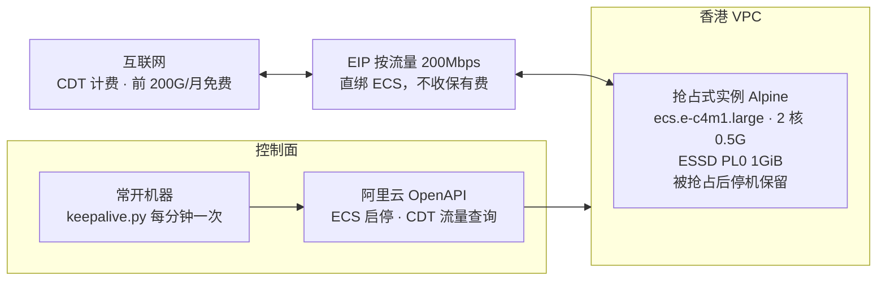

# 设计决策与背景

## 结果

| 项 | 值 |
| --- | --- |
| 实例 | ecs.e-c4m1.large（2 核 0.5G），香港，抢占式，可用区按抢占价自动选，被抢占后停机保留 |
| 系统 | Alpine 3.22，自定义镜像 alpine-cloud（官方 cloud-init qcow2 导入），ESSD PL0 1GiB |
| 公网 | EIP 按流量 200Mbps，按 CDT 计费，直绑实例 |
| 登录 | `ssh alpine@<EIP>`，密钥对由 provision 导入，`doas` 免密提权 |
| 费用 | 实例 0.00576 + 盘 0.00092 ≈ 0.0067 元/时 ≈ 4.8 元/月；公网流量前 200G/月免费 |
| 实测 | 从 Alpine CDN 下载约 130MB/s；内存 436M 开机用 44M |

真实资源 ID 只在 `state/<name>.json`。

## 架构

左边是控制面：常开机器通过 OpenAPI 查流量、启停实例。右边是数据面：公网流量经 EIP 进出实例，由 CDT 计费。停机期间只付 1GiB 盘费，每月不到 1 元。

## 为什么这样做

| 决策 | 原因 |
| --- | --- |
| 自定义镜像而不是公共镜像 | 公共镜像自身 20G，系统盘不能小于镜像，20GiB ESSD Entry 约 10 元/月，比实例还贵。自定义镜像可以把盘设成 1GiB，这是原帖 4 元/月的真正来源 |
| Alpine 官方 cloud-init qcow2 而不是原帖的 ISO | 导入即用：cloud-init 识别阿里云数据源（DataSourceAliYunLocal），密钥对自动注入，根分区自动扩到整盘，不用 VNC 手工 setup-alpine。实测一次成功 |
| 盘用 cloud_essd PL0 1GiB | 只有 cloud_essd 允许 1GiB；ESSD Entry 最小 10GiB，cloud_efficiency 最小 20GiB |
| 规格 ecs.e-c4m1.large | 香港抢占价最低档（约 0.006 元/时），与原帖一致；t6 同价但有 CPU 积分限制 |
| 被抢占后停机保留（SpotInterruptionBehavior=Stop） | 被回收只停机不释放，保活脚本下一轮可直接启动，不用重建 |
| 节省停机（StoppedMode=StopCharging） | 停机期间不收实例费，盘和 EIP 保留 |
| EIP 按流量，不建共享带宽 | 账号创建共享带宽被风控拒绝；EIP 自带 200Mbps 够用，CDT 免费额度同样覆盖 |
| 镜像导入需要角色而不是给 AK 授权 | 读 OSS 的是 ECS 服务，不是你的 AK；它只能扮演账号里的角色。实测 AK 已有 AliyunOSSFullAccess 仍报 NoSetRoletoECSServiceAcount |
| 保活阈值 180G | CDT 免费 200G，留 20G 余量给统计延迟 |
| 保活跑在另一台机器 | 放在实例里的话停机后没人把它拉起来 |
| config.yaml 只要 AK/SK | 地域、阈值、间隔有默认值；实例 ID 按名字或 state 找，不需要人填 |
| 中转机上传（oss_bridge.py） | 本机到香港 OSS 上行约 90KB/s，180MB 要半小时且会超时；临时实例在香港下载 + 内网上传 30 秒完成，AK 不落地，只用预签名 URL |

## 本次耗时分布

整个过程约 2 小时：脚本执行约 10 分钟，其余耗在账号级的人工操作和排错上（OSS 未开通、EIP 权限、余额、镜像导入角色，各一轮）。README 把这些前置条件一次列全就是为了避免重复。

## 清理与重建

- 建完可删：OSS bucket 里的镜像文件（约 250MB）、没用的 ISO 自定义镜像及快照。留着每月不到 0.2 元。
- 保留 alpine-cloud 镜像，实例被释放时一条命令重建：`provision.py --image alpine-cloud --no-cbwp`，VPC/安全组/密钥对/EIP 自动复用。
- 彻底下线顺序：实例 → EIP（解绑后释放）→ 安全组 → 交换机 → VPC → 镜像和快照 → OSS bucket。
